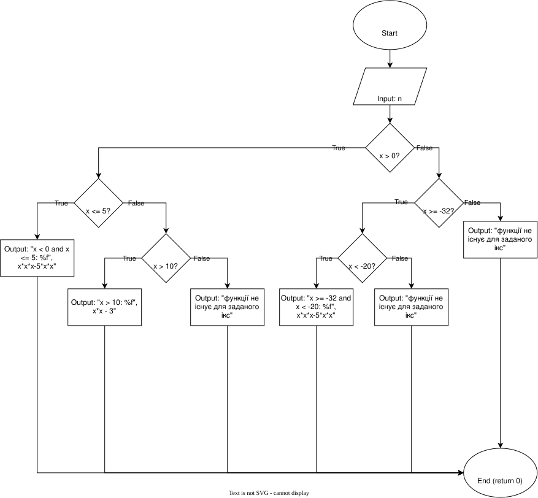
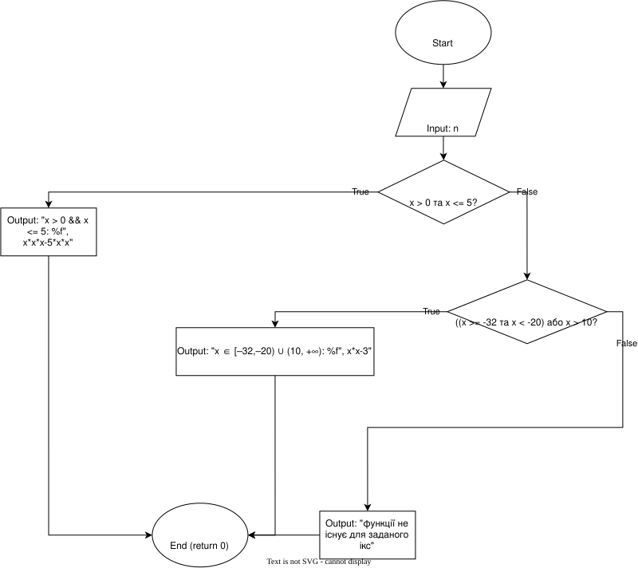
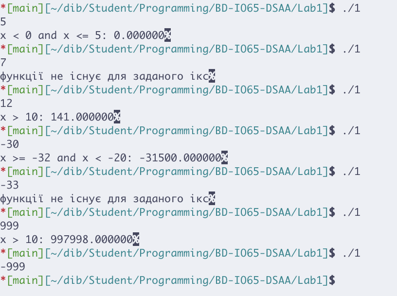
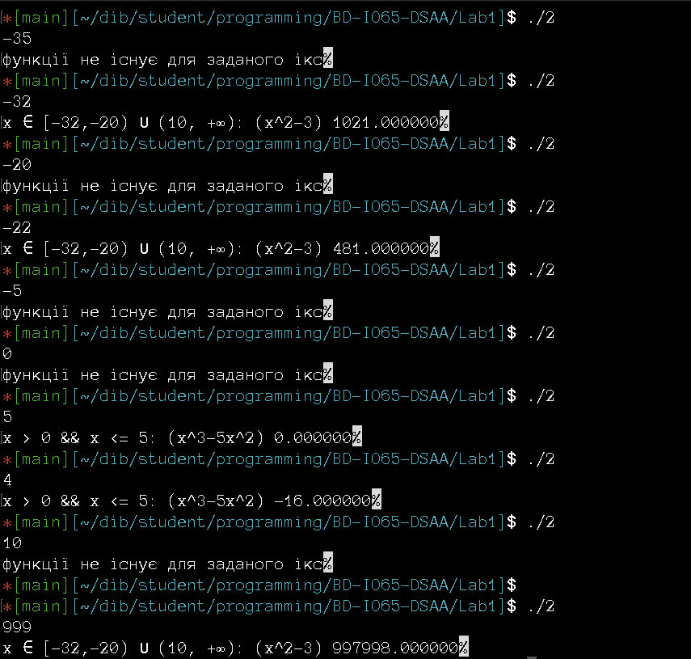

Національний технічний університет України "Київський політехнічний інститут ім. І. Сікорського"
Факультет інформатики та обчислювальної техніки

Алгоритми та структури даних

Виконав студент групи: ІО-65 Богданов Дмитро
Номер у списку групи: 2
Перевірив: Русінов Володимир Володимирович

# Лабораторна робота №1. Розгалужені алгоритми

## Мета лабораторної роботи
Метою лабораторної роботи «Розгалужені алгоритми» є засвоєння теоретичного матеріалу та набуття практичних навичок використання керуючих конструкцій розгалуження та булевих (логічних) операцій.

## Завдання лабораторної роботи
Визначити значення заданої за варіантом кусково-неперервної функції y(x), якщо воно існує, або вивести на екран повідомлення про неіснування функції для заданого x; розвʼязати задачу двома способами.
Для **другого варіанту** наступна умова: $x^3-5x^2,\space x \in (0,5]\space (f(x),\space x \in D_1);\newline x^2-3,\space x \in [-32,-20)\space \cup (10;+\infty)\space (f(x),\space x \in D_2).$

## Блок-схеми

- Для завдання 1:

- Для завдання 2:

## Код

Присутній в репозиторії.

## Світлини результатів виконання програми

- Код 1:
Для перевірки взяв такі числа: -35 (не існує функції в цій точці), -32, -30 (x ∈ [–32,–20) ∪ (10, +∞)), -20, -5, 0 (не існує функції в цій точці), 4, 5 (x ∈ [0, 5)), 10 (не існуєb функції в цій точці), 12 (x ∈ [–32,–20) ∪ (10, +∞)).

- Код 2:
Для перевірки взяв такі числа: -35 (не існує), -32 (x ∈ [–32,–20) ∪ (10, +∞)), -30 (x ∈ [–32,–20) ∪ (10, +∞)), -20, -5, 0 (не існує), 4, 5 (x ∈ [0, 5)), 10 (не існує), 12 (x ∈ [–32,–20) ∪ (10, +∞)).

