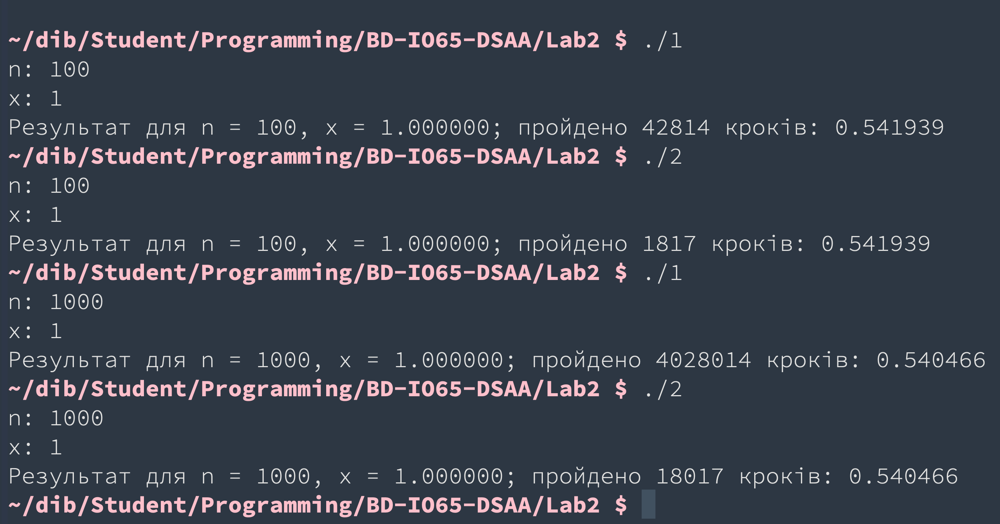
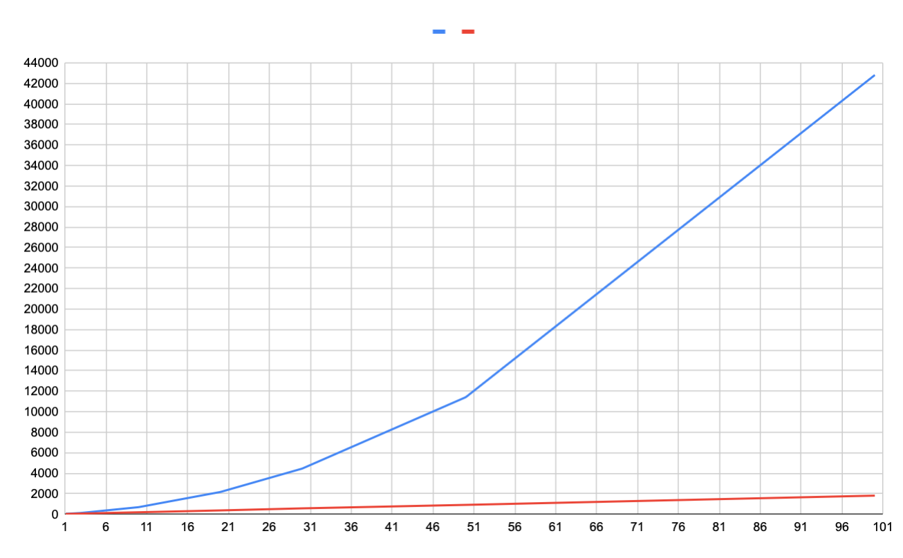
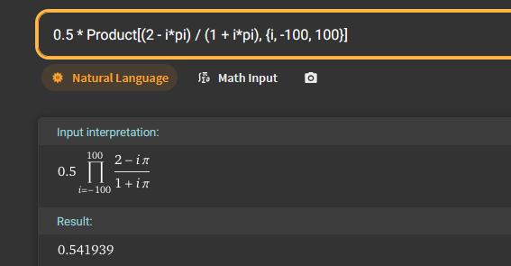
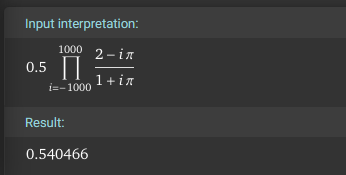
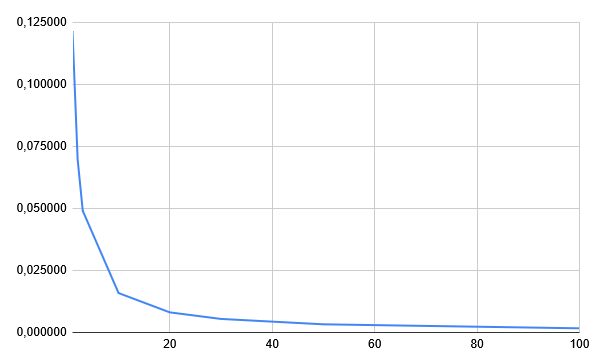

Національний технічний університет України "Київський політехнічний інститут ім. І. Сікорського"
Факультет інформатики та обчислювальної техніки

Алгоритми та структури даних

Виконав студент групи: ІО-65 Богданов Дмитро

Номер у списку групи: 2

Перевірив: Русінов Володимир Володимирович

# Лабораторна робота №2. Розгалужені алгоритми

## Мета лабораторної роботи
Засвоєння теоретичного матеріалу та набуття практичних навичок використання різних циклічних керуючих конструкцій, вкладених циклів, методу динамічного програмування та обчислення кількості операцій алгоритмів.

## Завдання лабораторної роботи
Обчислити значення формули -- перша програма має розраховувати за допомогою вкладених циклів, натомість друга має розраховувати за допомогою методу дин. програмування.
**2-й варіант**.

## Код

Присутній в репозиторії.

## Світлини результатів виконання програми

- Тестування програми

## Графік кількость операцій

(Синій -- метод вклад. циклів, червоний -- дин. програмування) (Вісь OX -- знач. n, OY -- знач. кіль-ть операцій)

## Перевірка правильности обчислень на калькуляторі

## Графік похибки

## Висновки

Отже, після виконання лаб. роботи стало очевидно, що за кількістю операцій метод динамічного програмування набагато ефективніший за метод вкладених циклів; також було закріплено фундаментальні знання з мови C (умови, цикли, ввід/вивід тощо), відповідно методи вкладених циклів та динамічного програмування.x
