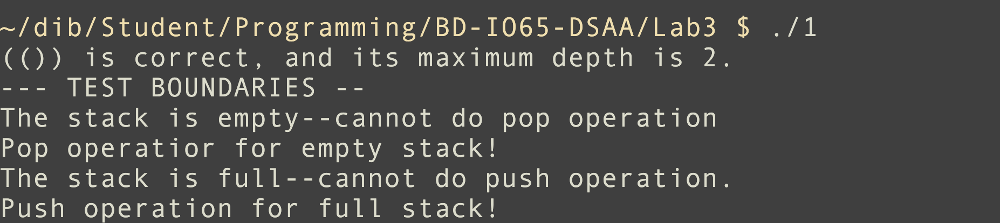
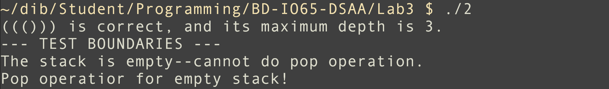

Національний технічний університет України "Київський політехнічний інститут ім. І. Сікорського"
Факультет інформатики та обчислювальної техніки

Алгоритми та структури даних

Виконав студент групи: ІО-65 Богданов Дмитро

Номер у списку групи: 2

Перевірив: Русінов Володимир Володимирович

# Лабораторна робота №3. Стеки та черги

## Мета лабораторної роботи
Засвоєння теоретичного матеріалу та набуття практичних навичок реалізації й застосування абстрактних структур даних стек (LIFO — «останнім прийшов, першим вийшов») та черга (FIFO — «першим прийшов, першим вийшов»), а також порівняння двох способів їхньої реалізації — на основі масиву фіксованого розміру та на основі однозв'язного списку.

## Завдання лабораторної роботи
Розвʼязати прикладу задачу, використовуючи певні структури даних (стек або черга в залежности від умови) -- перша програма має розвʼязувати прикладу задачу на основі одновимірного списку, інша -- однозвʼязного списку.
**2-й варіант** (Стеком перевірити правильність вкладення дужок одного виду () у рядку та додатково визначити максимальну глибину вкладення (найбільшу кількість одночасно відкритих дужок).

## Код

Присутній в репозиторії.

## Світлини результатів виконання програми

- Тестування програми

## Висновки

Отже, за умовою завдання, в ході виконання лабораторної роботи використовувалася реалізація стеку за масивом та однозвʼязним списком. Головною різницею між цими двома реалізаціями полягає в обмеженні памʼяттю: масив потребує певне обмеження (в лаб. роботі я використав обмеження в 100 елементів), тоді як однозвʼязний список створює вузли в оперативній памʼяті доти, доки не закінчиться весь вільний простір. В цілому, стек на масиві є простішим в реалізації, бо стек на однозвʼязному списку потребує уважного виділення памʼяті. Поводження при переповненні є простим: на масиві -- перевіряється, чи є вершина більшою за встановлене обмеження; для списку (у випадку ненагромаджених застосувань структури) переповнення трапляється лише після заповнення оперативної памʼяті. Перевірка на видалення зі вже порожнього масиву або списку відбувається за вершиною -- в першому випадку перевіряється, чи вершина дорівнює -1, а в другому випадку -- чи вершина дорівнює NULL.
