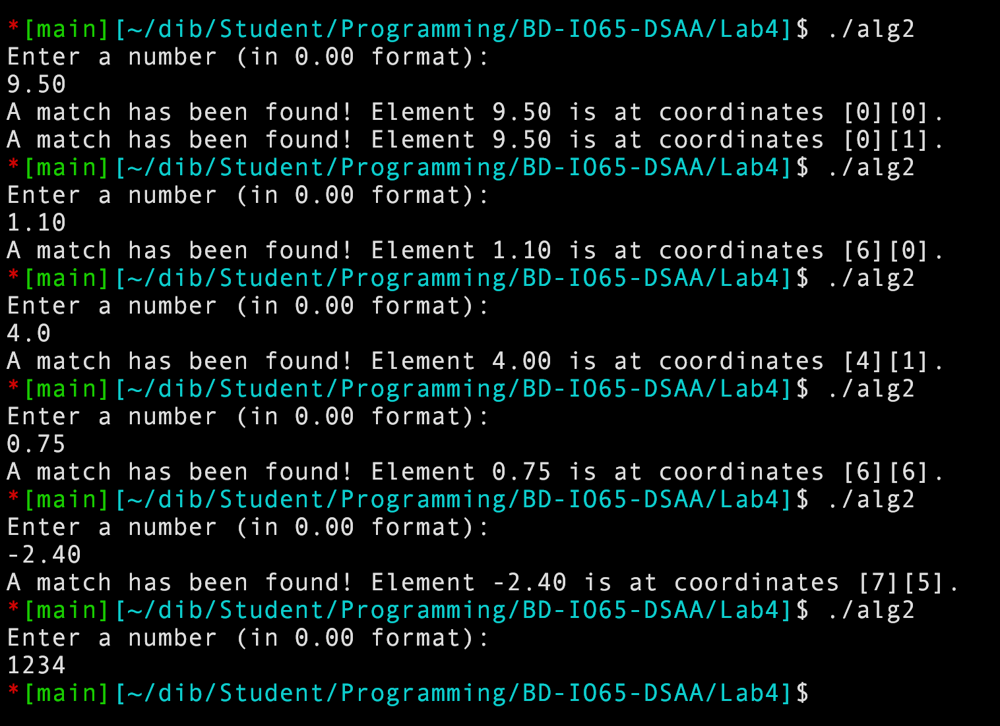

Національний технічний університет України "Київський політехнічний інститут ім. І. Сікорського"
Факультет інформатики та обчислювальної техніки

Алгоритми та структури даних

Виконав студент групи: ІО-65 Богданов Дмитро

Номер у списку групи: 2

Перевірив: Русінов Володимир Володимирович

# Лабораторна робота №4. Алгоритми двійкового пошуку

## Мета лабораторної роботи
Засвоєння теоретичного матеріалу та набуття практичних навичок розв'язання задачі пошуку заданої категорії елементів за допомогою різних алгоритмів методу двійкового пошуку у двовимірних масивах.

## Завдання лабораторної роботи
Написати програму розв'язання задачі пошуку у двовимірному масиві розміром M x N заданого елементу у кожному стовпці методом двійкового пошуку (а саме за другим алгоритмом). (**2-й варіант**).
   
## Код

Присутній в репозиторії.

## Світлини результатів виконання програми

- Тестування програми (там є і вхідні дані)

## Висновки

Отже, за результатами лабораторної роботи, я перевірив на практиці теорію щодо двійкового пошуку (а саме алгоритм №2, як вказано у варіанті). Алгоритм №2 працює коректно для всіх зазначених у вимогах варіантах (елемент стоїть посередині, ліворуч, праворуч або відсутній) (тому підтвердження є світлина тестування програми). Якщо елементи повторюються, виводиться найлівіший, якщо повтор відбувається у декількох стовпцях, виводяться відповідні найлівіші елементи -- це і є основа відмінність від алгоритму №1, де програма закінчує свою роботу, щойно знайдеться збіг. Згідно презентації, складність пошуку для двійкового пошуку є O(log_2(M)) -- і в порівнянні з лінійним пошуком, двійковий є набагато ефективнішим -- лінійний для одного стовпця зробить 8 порівнянь, тоді як двійковий -- 3 ітерації.
