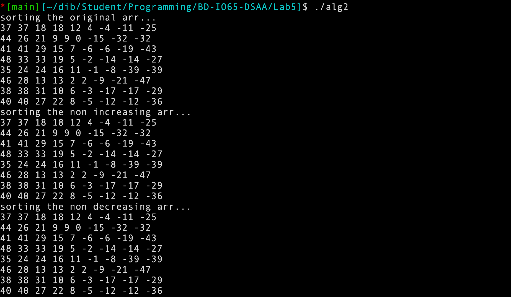

Національний технічний університет України "Київський політехнічний інститут ім. І. Сікорського"
Факультет інформатики та обчислювальної техніки

Алгоритми та структури даних

Виконав студент групи: ІО-65 Богданов Дмитро

Номер у списку групи: 2

Перевірив: Русінов Володимир Володимирович

# Лабораторна робота №5. Алгоритми сортування

## Мета лабораторної роботи
Засвоєння теоретичного матеріалу та набуття практичних навичок розв'язання задачі сортування заданої категорії елементів за допомогою різних алгоритмів сортування у двовимірних масивах.

## Завдання лабораторної роботи

Рядково відсортувати довільну матрицю розміром M x N за алгоритмом №2 методу вставки (з лінійним пошуком справа) за незбільшенням. **2-й варіант**. 
   
## Код

Присутній в репозиторії.

## Світлини результатів виконання програми

- Тестування програми

## Висновки

Отже, сортування матриці було виконано за допомогою алгоритму №2 методу вставки (з лінійним пошуком справа). Для невідсортованої матриці алгоритм поводить себе "як має", бо елементи розташовані у випадковому порядку (складність при цьому сягає O(n^2) -- для одного рядка). Для відсортованої за незменшенням матриці алгоритм виконується швидше всього, бо жодних операцій зсувів елементів не відбувається (складність в такому випадку для сортування одного рядка лінійна -- O(n)). Для відсортованої навпаки алгоритм виконується найповільніше, бо кожен наступний елемент є більший за всі попередні, тобто алгоритм змушений дійти до самого початку рядка й зсунути туди всі попередні елементи (при цьому складність сягає O(n^2), бо сума операцій в такому випадку формує арифметичну прогресію, звідки й виноситься n^2 -- для одного рядка). Загалом, практика відповідає теоретичній складности.
